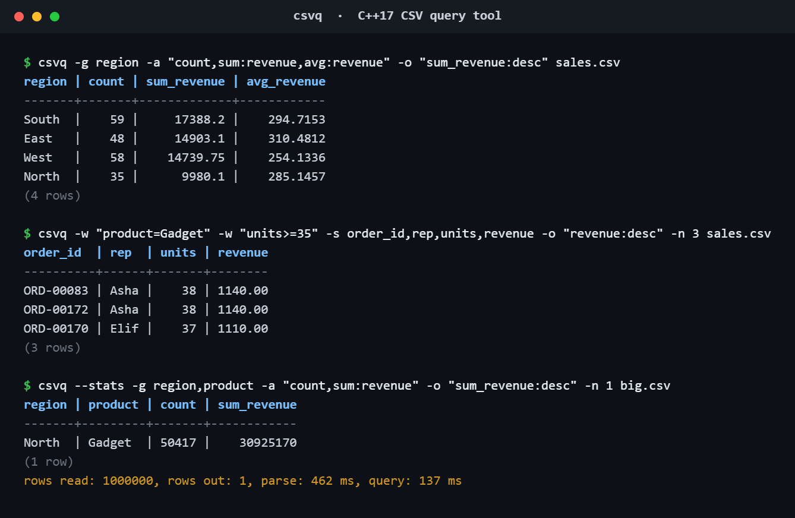

# csvq

**Query CSV files from the command line: filter, group, aggregate, sort and export, in one fast C++17 binary with no dependencies.**

[](https://github.com/ritanjay/csvq/actions/workflows/ci.yml)



## Why

Spreadsheets choke on big exports, and writing a one-off Python script for every question is slow. `csvq` answers the everyday questions ("top 10 orders in the West", "revenue by region and product", "give me just these columns as JSON") straight from the terminal, and it is easy to drop into scripts and scheduled jobs.

## Features

- **RFC 4180 parser**: quoted fields, escaped quotes (`""`), newlines inside quotes, CRLF line endings, UTF-8 BOM, custom delimiters (TSV too)
- **Filters**: `=  !=  <  <=  >  >=` plus `~` (case-insensitive contains); repeat `-w` to AND them together
- **Smart comparisons**: numeric when both sides are numbers (`9 < 10 < 100`), text otherwise
- **Group by** one or more columns with `count`, `count:col`, `sum`, `avg`, `min`, `max`
- **SQL-like blanks**: empty cells never match `<`/`>` filters, are skipped by aggregates, and always sort last
- **Multi-key sort** (`-o "region,revenue:desc"`), column selection, row limit
- **Output** as an aligned table, CSV or JSON (numbers stay numbers, blanks become `null`)
- **Clear errors** with line numbers and the list of valid column names; exit codes `0` OK, `1` data error, `2` usage error

## Build

Requires a C++17 compiler and CMake ≥ 3.16. No third-party libraries.

```bash
cmake -S . -B build -DCMAKE_BUILD_TYPE=Release
cmake --build build --config Release
ctest --test-dir build -C Release --output-on-failure   # 21 unit tests + CLI smoke test
```

The binary is `build/csvq` (Linux/macOS) or `build\Release\csvq.exe` (Windows with Visual Studio).
On Windows you can also open the folder directly in Visual Studio or VS Code with the CMake Tools extension.

## Usage

```text
csvq [options] FILE           (use - to read from stdin)

  -s, --select COLS        Comma-separated output columns
  -w, --where COND         Filter rows; repeat for AND
  -g, --group-by COLS      Comma-separated grouping columns
  -a, --agg LIST           count, count:col, sum:col, avg:col, min:col, max:col
  -o, --sort KEYS          e.g. "total:desc,name"
  -n, --limit N            Keep at most N rows
  -f, --format FMT         table (default), csv or json
  -d, --delimiter CHAR     Input delimiter (default ','; use '\t' for TSV)
      --stats              Rows read and timing on stderr
```

Steps run in SQL order: **where → group/aggregate → sort → select → limit**.

### Examples

Top orders matching two filters:

```text
$ csvq -w "product=Gadget" -w "units>=35" -s order_id,date,rep,units,revenue \
       -o "revenue:desc" -n 5 examples/sales.csv
order_id  | date       | rep   | units | revenue
----------+------------+-------+-------+--------
ORD-00083 | 2026-05-16 | Asha  |    38 | 1140.00
ORD-00172 | 2026-08-12 | Asha  |    38 | 1140.00
ORD-00170 | 2026-01-11 | Elif  |    37 | 1110.00
ORD-00191 | 2026-07-16 | Diego |    37 | 1110.00
ORD-00160 | 2026-02-08 | Asha  |    36 | 1080.00
(5 rows)
```

JSON for another program or an API:

```text
$ csvq -g rep -a "sum:revenue" -o "sum_revenue:desc" -n 2 -f json examples/sales.csv
[
  {"rep": "Asha", "sum_revenue": 16007.8},
  {"rep": "Diego", "sum_revenue": 12518.35}
]
```

In a pipeline:

```bash
cat export.csv | csvq -w "status=failed" -s id,email -f csv - > failed.csv
```

## Performance

1,000,000 rows (53 MB), grouping by two columns with count and sum, on a 2-core Linux VM:

| Tool | Time |
|---|---|
| `csvq` | **0.65 s** (parse 0.45 s + query 0.15–0.2 s) |
| Python `csv.DictReader` loop doing the same aggregation | 2.19 s |

Results were cross-checked against Python for exact equality. Reproduce with:

```bash
python3 examples/generate_sample.py 1000000 > big.csv
csvq --stats -g region,product -a "count,sum:revenue" -o "sum_revenue:desc" big.csv
```

## Quality checks

- 21 unit tests covering the parser edge cases, query semantics and output formats
- Builds with **zero warnings** on GCC and Clang with `-Wall -Wextra -Wpedantic -Wshadow -Wconversion`
- Test suite and CLI run clean under **AddressSanitizer and UndefinedBehaviorSanitizer**
- Fuzzed round-trip: 3,000 random rows full of quotes, commas, CRLFs, embedded newlines and UTF-8 parse and re-serialise byte-for-byte identical to Python's `csv` module
- CI builds and tests on Linux, macOS and Windows

## Project layout

```text
include/csvq/   public headers: csv.hpp (parse/write), query.hpp (engine), format.hpp (output)
src/            implementation + main.cpp (CLI)
tests/          dependency-free unit tests (registered with CTest)
examples/       sample data and a generator for large test files
```

## Extending it

- **New aggregate** (e.g. `median`): add it to `AggFn` and `parse_aggregates` in `query.hpp/.cpp`, then compute it in `Accumulator::result`.
- **New output format**: add a value to `Format`, a writer in `format.cpp`, and a case in `write()`.
- **New filter operator**: add it to `Op`, the operator table in `parse_condition`, and `matches()`.

## Notes and limits

- The whole file is loaded into memory (about 2–3× the file size). That's fine for files up to a few GB; streaming aggregation would be the next step for larger ones.
- Sample data in `examples/` is randomly generated; it contains no real people or companies.

## License

MIT, see [LICENSE](LICENSE).
